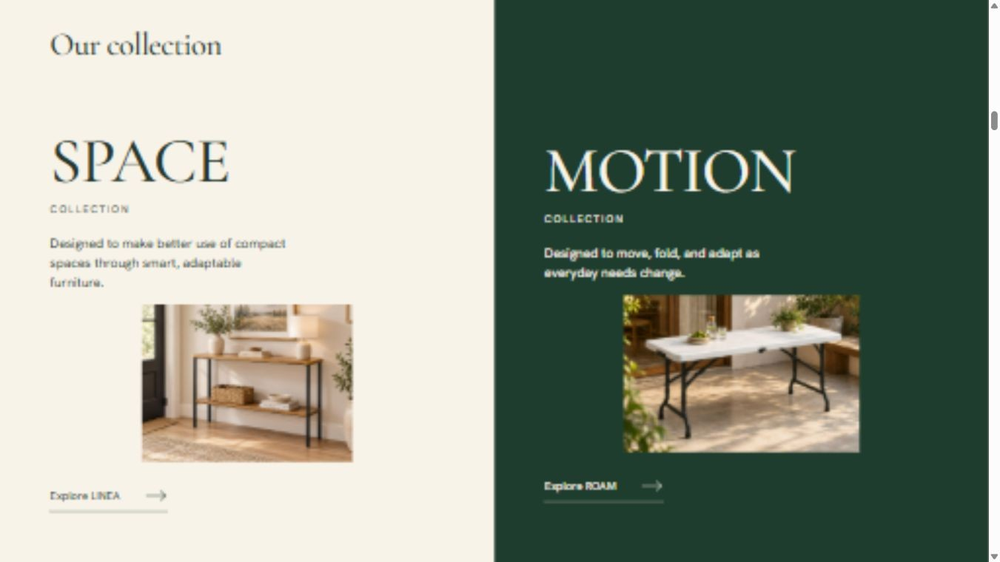
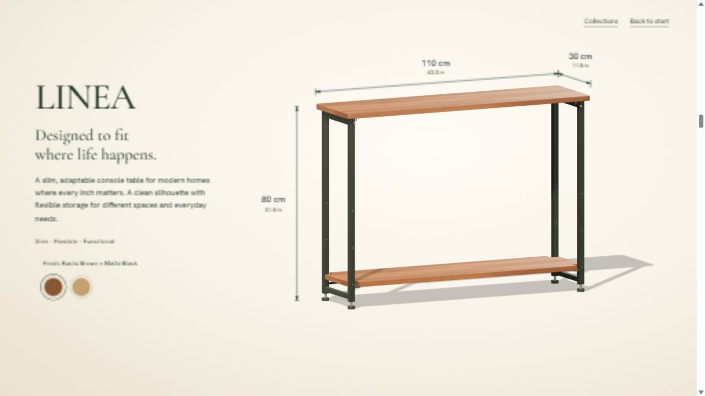
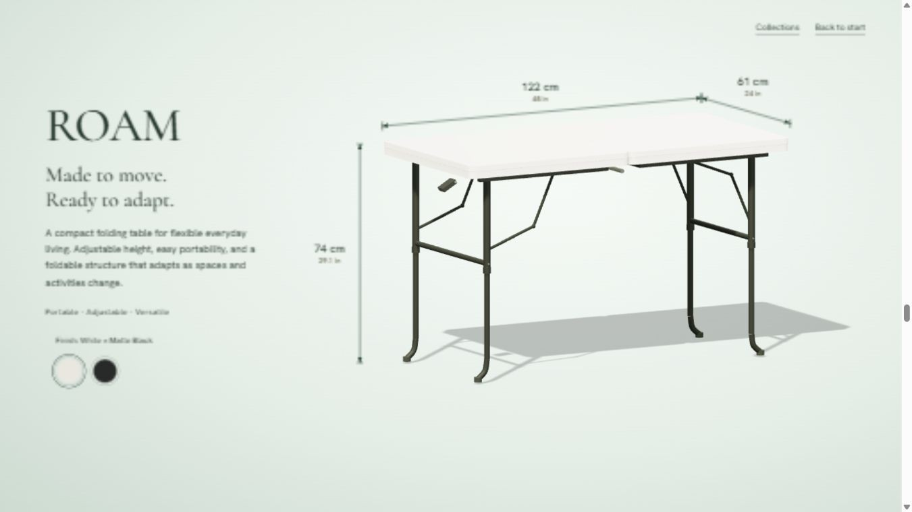

<div align="center">

# NetNest

**NÉT NEST · SPACE / LINEA × MOTION / ROAM**

Website thuyết trình nội thất 3D tương tác bằng cuộn trang.



**Three.js r152.2 · GSAP / ScrollTrigger 3.12.5 · HTML / CSS / JavaScript**

[Xem website](https://nhutwang.github.io/NetNest/) · [Mã nguồn](https://github.com/nhutwang/NetNest) · [Chạy local](#chay-local) · [Trải nghiệm](#trai-nghiem) · [Cấu trúc](#cau-truc) · [GitHub & deploy](#github-deploy)

</div>

NetNest giới thiệu **LINEA**, bàn console với kệ điều chỉnh vị trí, và **ROAM**, bàn gập thay đổi chiều cao. Camera, mô hình, ảnh và chữ chuyển cảnh theo thao tác cuộn; cuộn ngược quay về trạng thái trước. Website phục vụ bài thuyết trình khoảng 7 phút, không có chế độ video tự chạy hoặc bộ đếm thời gian.

> Website trình bày concept từ ảnh tham chiếu, chưa phải CAD sản xuất hoặc mô phỏng cơ khí đã kiểm định. Giá hiển thị là **giá đề xuất**: LINEA **$99.99**, ROAM **$74.99**, đối chiếu NỘI DUNG EEC.docx, mục SLIDE CONTENT và [listing Canva](https://www.canva.com/design/DAHZCC5ljzc/6Aml3CaUvXyVT2g4EyagzQ/edit) ngày 27/10/2026.

<table>
  <tr>
    <td width="50%"><br><b>LINEA · SPACE</b></td>
    <td width="50%"><br><b>ROAM · MOTION</b></td>
  </tr>
</table>

<a id="chay-local"></a>

## Chạy local

Cần **Node.js 18 trở lên** và Internet để tải thư viện/phông chữ từ CDN. Dự án không có dependency npm và không cần `npm install` hoặc build để chạy.

1. Giải nén `NetNest.zip`, mở thư mục `NetNest/` hoặc file `NetNest.code-workspace` bằng VS Code.
2. Chạy trong terminal:

```bash
npm run dev
```

3. Mở [localhost:3000](http://localhost:3000/). Dùng `Ctrl+C` để dừng máy chủ.

Windows có thể nháy đúp `chay-web.cmd`, sau đó mở địa chỉ được in trong terminal. Nếu cổng 3000 đang được dùng:

```bash
npm run dev -- --port 3001
```

Nếu chỉ có Python, chạy tại thư mục chứa `index.html`:

```bash
python -m http.server 3000 --bind 127.0.0.1
```

Nên chạy qua HTTP hoặc Live Server thay vì mở bằng `file://`. Bốn ảnh nguồn có sẵn trong `assets/`; Three.js, GSAP, ScrollTrigger và Google Fonts vẫn cần Internet.

<a id="trai-nghiem"></a>

## Trải nghiệm và nội dung

Cuộn xuống để tiến câu chuyện; cuộn lên để xem lại. Dừng cuộn tại cấu hình cần giải thích. Chọn **Explore LINEA / Explore ROAM** ở bộ sưu tập để tới model tương ứng. Trong cảnh kích thước đầy đủ, bấm mẫu màu để thay vật liệu trực tiếp: Rustic Brown / Natural Oak cho LINEA và White / Black cho ROAM. Camera và cơ cấu model được điều khiển bằng tiến trình cuộn.

| Cảnh | Nội dung |
| --- | --- |
| 01 · Brand | Ảnh mở đầu, logo và giải nghĩa NÉT / NEST |
| 02 · Vision | Rooted in Vietnam. Designed for modern living. |
| 03 · Collections | Hai mảng SPACE / MOTION và nút Explore tới model |
| 04 · LINEA | Ảnh sản phẩm trong không gian sống, chuyển vào model |
| 05 · LINEA details | Kích thước 110 × 30 × 80 cm; kệ 10/25/40 cm; vật liệu, vít/giá đỡ và exploded view |
| 06 · Match cut | Chuyển từ LINEA sang ROAM |
| 07 · ROAM details | Kích thước 122 × 61 × 74 cm; chiều cao 55/65/74 cm; lật, thu/gập chân, gập đôi, chốt, xách, vật liệu và carton |
| 08 · Products | Ảnh nguyên sản phẩm và hai giá đề xuất |
| 09 · End | Hai góc nhìn, một triết lý thiết kế |

Khung đo dùng hình chiếu song song theo ảnh mẫu: thước dài ở cạnh sau, thước sâu gặp tại góc chung, thước cao đứng dọc. Thước có mũi tên hai đầu, cm và inches; số đo cập nhật theo model khi nâng hạ. Chú thích chi tiết nối bằng một đoạn thẳng có fade. LINEA dùng ivory ấm, ROAM dùng xám xanh nhạt. Vân MFC tạo theo seed, bề mặt thép đen mờ và HDPE có microtexture; camera chuyển góc theo quỹ đạo quanh sản phẩm, giữ khoảng cách có chủ đích để tránh zoom ngoài ý muốn.

Một GSAP ticker và một master ScrollTrigger điều khiển câu chuyện. Có nhánh reduced-motion và ảnh thay thế khi không dựng được WebGL. Kiểm tra mạng, máy trình chiếu và toàn bộ hành trình cuộn trước buổi trình bày.

<a id="cau-truc"></a>

## Cấu trúc dự án

```text
NetNest/
├── index.html                   # Nguồn web duy nhất: HTML, CSS, 3D, timeline
├── assets/                      # 4 ảnh chạy trên website
│   ├── brand-garden.jpg
│   ├── netnest-logo.jpg
│   ├── linea-lifestyle.jpg
│   └── roam-lifestyle.jpg
├── docs/
│   ├── images/                  # Ảnh minh họa README
│   └── PDF_FIXES.md             # Đối chiếu góp ý và phạm vi kiểm thử
├── scripts/
│   ├── serve.mjs                # Máy chủ local dùng Node.js tiêu chuẩn
│   └── check.mjs                # Kiểm tra state, motion, ảnh và syntax
├── .github/workflows/pages.yml  # Kiểm tra và deploy GitHub Pages
├── NetNest.code-workspace       # Mở dự án trong VS Code
├── chay-web.cmd
├── package.json
├── .gitignore
├── .gitattributes
├── .nojekyll
├── AGENTS.md                    # Quy tắc bảo trì
└── README.md
```

`README.md` là file tài liệu chính để GitHub tự hiển thị. Giữ `index.html` ở gốc, dùng đường dẫn ảnh tương đối để website chạy được dưới `/NetNest/`. CSS và JavaScript tiếp tục nằm inline; không có renderer, thư viện local hoặc bản build trùng.

## Kiểm tra

```bash
npm run check
```

Lệnh kiểm tra chín chương, camera đo cố định, bố cục thước theo ảnh mẫu, số đo động, điểm đến Explore, nội dung thương hiệu/vision, fade chú thích, thứ tự gập/đóng gói, tính xác định khi cuộn ngược/nhảy mốc, bốn ảnh nguồn, giá, JavaScript inline và ảnh README.

Đã xem trực quan ở desktop và viewport mobile; đây chưa phải nghiệm thu touch/iOS/Android thật hoặc đo FPS trên máy thi. Chi tiết và giới hạn nằm trong [docs/PDF_FIXES.md](docs/PDF_FIXES.md).

<a id="github-deploy"></a>

## Đưa lên GitHub và deploy

### 1. Tạo repository

Tạo repo tên **NetNest** trên tài khoản của bạn. Nếu dùng các lệnh bên dưới, tạo repo trống, không thêm README hay `.gitignore` trên GitHub. Thay `nhutwang` bằng tài khoản thực của bạn.

Tại thư mục dự án, nếu chưa có Git:

```bash
git init -b main
```

Sau đó:

```bash
git add .
git commit -m "Prepare NetNest website"
git remote add origin https://github.com/nhutwang/NetNest.git
git push -u origin main
```

Nếu Git yêu cầu danh tính, cấu hình tên/email của chính bạn tại repo trước khi commit. Không đưa API key, mật khẩu hay file môi trường vào Git. `releases/`, ZIP, cache, `_site/` và các kết quả nghiên cứu local trong `output/` đã được ignore.

Có thể dùng **Add file → Upload files** thay cho terminal, nhưng phải đưa cả `.github/workflows/pages.yml`, `.nojekyll` và các file cấu hình dấu chấm lên đầy đủ. `index.html` và `assets/` phải nằm ngay ở gốc repo, không lồng thêm một thư mục `NetNest/` trong repo.

### 2. Bật GitHub Pages

Trong repository, vào **Settings → Pages → Build and deployment → Source**, chọn **GitHub Actions**. Sau đó mở **Actions → Check and deploy NetNest → Run workflow** trên nhánh `main` nếu lần push đầu đã xảy ra trước khi bật Pages.

Workflow sẽ:

1. Chạy `npm run check` trên Node.js 22.
2. Đóng gói `index.html`, `.nojekyll` và 4 ảnh trong `assets/` vào `_site/` tạm thời.
3. Upload artifact và deploy lên môi trường `github-pages`.

Mỗi lần push vào `main` sẽ kiểm tra và deploy lại. Pull request chỉ chạy kiểm tra. Hướng dẫn cấu hình theo [tài liệu GitHub Pages](https://docs.github.com/en/pages/getting-started-with-github-pages/using-custom-workflows-with-github-pages).

GitHub hiển thị URL thật trong **Settings → Pages** và kết quả job deploy; dạng thường gặp là `https://nhutwang.github.io/NetNest/`. Website chính thức: [nhutwang.github.io/NetNest](https://nhutwang.github.io/NetNest/).

### 3. Xác nhận sau deploy

Mở URL do GitHub cung cấp, kiểm tra logo/ảnh, cuộn đủ chín cảnh, thước ba chiều, nâng hạ, gập và hai giá. Thử cuộn ngược, màn hình dọc và tải lại dưới đường dẫn repo. Nếu workflow lỗi, xem job tương ứng trong tab Actions.

Website đã được push lên [nhutwang/NetNest](https://github.com/nhutwang/NetNest) và deploy bằng GitHub Pages ngày 26/10/2026. Cả job kiểm tra/đóng gói và deploy đã chạy thành công trên GitHub Actions. Các lần push tiếp theo vào `main` tự kiểm tra và deploy lại.

## Bảo trì và nguồn

Giữ `index.html` là nguồn chính. Khi đổi tên ảnh, cập nhật tham chiếu trong trang và danh sách đường dẫn ở `scripts/serve.mjs` cùng lúc. Website tĩnh, không có checkout, analytics hoặc backend.

- **Thiết kế, logo, ảnh:** tài liệu và bộ `net-nest-3d.zip` do nhóm cung cấp, cập nhật theo PDF góp ý và ảnh kích thước mới nhất.
- **3D và motion:** [Three.js](https://threejs.org/) 0.152.2; [GSAP / ScrollTrigger](https://gsap.com/) 3.12.5.
- **Phông chữ:** Cormorant Garamond và Hanken Grotesk qua [Google Fonts](https://fonts.google.com/).
- **Dữ liệu thị trường:** MPG cấp ITK trong 12 tháng; không phải doanh số NÉT NEST.

Mô hình và cơ cấu là minh họa concept, chưa kiểm định tải trọng, độ bền hoặc vận chuyển. Quyền ảnh/nhận diện theo nguồn của nhóm; dự án không tự cấp giấy phép mới cho tài sản đó.

<div align="center"><sub>NetNest · Vietnamese Roots × Modern Living</sub></div>
